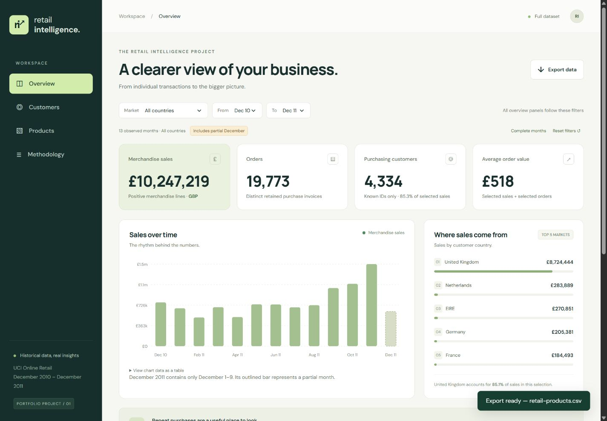
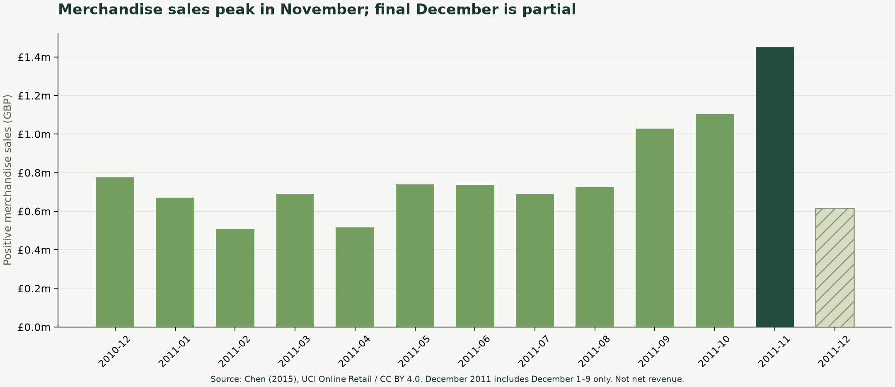
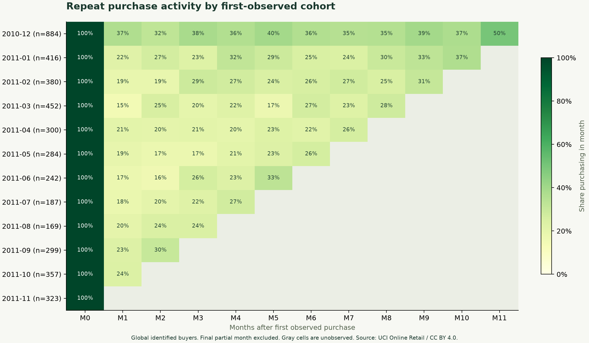

# Retail Intelligence

[](https://github.com/Boody700/retail-intelligence/actions/workflows/checks.yml)

**Auditable retail analytics using Python, pandas and SQLite, with RFM segments and customer cohorts.**

[Case study](docs/case-study.md) · [Interview notes](docs/interview-guide.md) · [Validation workflow](.github/workflows/checks.yml)

An end-to-end retail analytics project that turns 541,909 transaction lines into an interactive sales and customer dashboard. Built for a junior data science portfolio, with a reproducible Python pipeline, SQLite analysis, explicit metric definitions and validation.

## What you can explore

- **Overview:** filter markets and months; inspect merchandise sales, orders, purchasing customers, order value, monthly trends and geographic concentration.
- **Customers:** explore six transparent RFM segments and a complete-month cohort repeat-activity heatmap.
- **Products:** search stock codes and descriptions, rank products by sales, units or invoice appearances, and export the results.
- **Methodology:** trace every cleaning exclusion, metric definition and limitation.
- CSV exports reflect the current view and its stated filter scope.

This is a real historical-data case study. The interface does not use mock transactions, fabricated model scores or invented business outcomes.

## Results

| Measure | Result |
|---|---:|
| Source transaction lines | 541,909 |
| Retained merchandise lines | 522,540 |
| Merchandise sales | £10,247,219.32 |
| Retained purchase invoices | 19,773 |
| Identified purchasing customers | 4,334 |
| Identified buyers with repeat purchases | 65.3% |
| United Kingdom share of sales | 85.1% |

Sales refer to positive merchandise purchases after the documented exclusions. They are **not net revenue or profit**. December 2011 is partial. Read [the findings](docs/findings.md) and [the case study](docs/case-study.md) before interpreting these results.







## Run the dashboard

The precomputed dashboard is included. You only need Python 3.10+ to serve it; no analytical dependencies are needed for viewing.

```powershell
python scripts/serve.py
```

Open `http://127.0.0.1:4173`. On Windows, if `python` is unavailable but the Python launcher is installed, use `py` instead. Another port can be selected with `--port 4180`.

## Rebuild the analysis

Python 3.10+ is required. The initial build downloads the 23.7 MB source archive from UCI; later builds reuse it. Keep enough disk space for the local SQLite database. Run these commands from this project folder:

```powershell
python -m venv .venv
.venv\Scripts\python -m pip install -r requirements.txt
.venv\Scripts\python scripts/build_data.py
.venv\Scripts\python -m unittest discover -s tests -v
.venv\Scripts\python scripts/build_report.py
.venv\Scripts\python scripts/serve.py
```

On macOS/Linux, replace `.venv\Scripts\python` with `.venv/bin/python`. The analytical build uses pandas, NumPy and openpyxl. Matplotlib is used only for the standalone report charts.

With Node.js 18+, run dashboard interaction checks:

```powershell
node tests/dashboard.test.cjs
```

The interaction checks execute dashboard logic against a lightweight DOM harness. Desktop and phone layouts, filters, market cohorts, product search and a native CSV download were also verified in a real browser. This does not substitute for a full accessibility audit. See [validation](docs/validation.md) for the verification performed and its limitations.

## Project structure

```text
dist/                    Deployable static dashboard and aggregated data
scripts/build_data.py    Download → cleaning → SQLite → customer/cohort analysis
scripts/build_report.py  Standalone analytical figures from the local database
scripts/serve.py          Loopback-only server that exposes dist/ only
sql/analysis.sql         Seven documented analytical queries
tests/                   Cleaning behavior, reconciliation and UI logic checks
data/quality.json        Source checksum, totals and cleaning audit
data/cleaning-audit.csv   Sequential row exclusions
data/customer-segments.csv  Market-level segment summaries, no customer IDs
docs/                    Case study, findings, data dictionary and interview guide
reports/                 Exported analytical figures
```

The raw archive and generated SQLite database are excluded from source control. Rebuilding recreates them. The website contains aggregated product/segment data and invoice summaries with opaque sequential customer keys; no original customer IDs are distributed in the dashboard. Opaque keys support counting unique and repeat buyers across date filters and are not an anonymity guarantee against linkage to the original public dataset.

## Analytical choices

1. Remove exact duplicate rows, then invalid required fields, cancellations, non-positive quantities/prices and non-merchandise codes in a reconciled sequential waterfall.
2. Preserve transactions without customer IDs for sales analysis; exclude them from customer-level analyses.
3. Represent line sales in integer pence to reconcile sums across Python, SQL and JavaScript.
4. Use stable stock codes and the most common observed description. Group frequency by invoice, not line count.
5. Use transparent RFM rules instead of calling descriptive segments a churn model.
6. Exclude the incomplete final month from cohort analysis. Missing future cohort cells stay unobserved rather than turning into false zeros.
7. Retain large orders and high spenders. Wholesale activity is part of the source population.

## Source and licensing

Chen, D. (2015). *Online Retail* [Dataset]. UCI Machine Learning Repository. https://doi.org/10.24432/C5BW33. Dataset license: CC BY 4.0. The project cleans and aggregates the original data; attribution is retained in the app and documentation. Source file integrity is recorded in `data/quality.json`.

Project code is available under the MIT license; the underlying dataset keeps its own license. Use the local preview instructions above to explore the complete application.


## Development

Independent, AI-assisted educational portfolio project. The source, evaluation design and limitations are documented so the work can be inspected and reproduced. GitHub Actions runs the committed browser checks. Python pipeline reproduction uses the commands and data sources described above.
